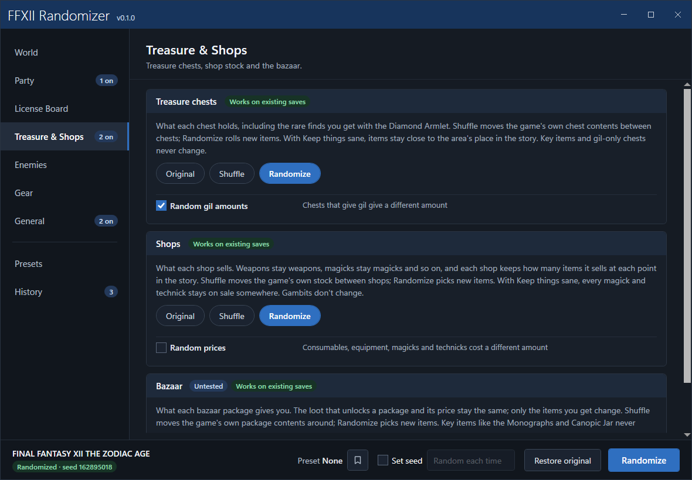
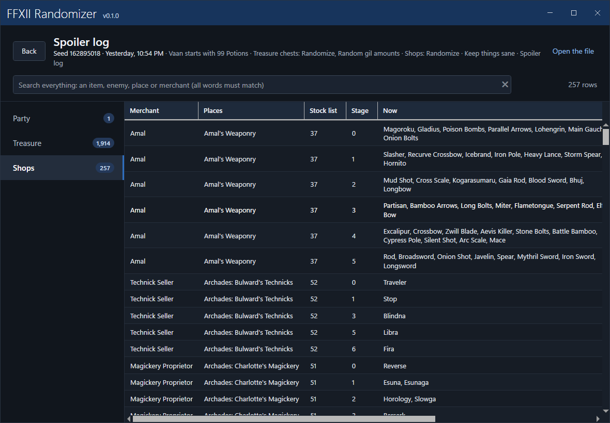

# FFXII Randomizer

Randomizer for **FINAL FANTASY XII THE ZODIAC AGE** (Steam), in the spirit of
[ffx-randomizer](https://github.com/ybadragon/ffx-randomizer). It needs no third-party mod loader:
it ships its own small `dinput8.dll` loader, and the 31 GB game archive is never modified.

## Getting started

1. Download `FFXII-Randomizer-vX.Y.Z.exe` from [Releases](../../releases). It's a single self-contained file with nothing
   else to install.
2. Close the game, then run the exe. Windows SmartScreen may warn because the app isn't signed; click
   **More info → Run anyway**.
3. Pick your options and click **Randomize**.
4. Launch the game. Most options work on existing saves (see the table below); the rest need a **New Game**.

The app finds your Steam copy automatically. If it can't, it asks you for the game folder.

| Pick your options | Find anything in the spoiler log |
|---|---|
|  |  |

To undo it, click **Restore original**. That removes the loader and the `ff12rando` folder; the game files themselves
are never changed.

## Features

| Option | Works on existing saves | Confirmed in game |
| --- | --- | --- |
| Open world (Bartz24's base, experimental) | new game | boots to the title screen; play untested |
| Treasure chests (shuffle/randomize, gil amounts) | yes, unopened chests | yes |
| Shops (shuffle/randomize) | yes | yes |
| Shop prices (consumables, equipment) | yes | not yet |
| Bazaar packages | yes | not yet |
| Enemy drops, steals, poaches | yes | not yet |
| Enemy stats | yes | not yet |
| Elemental affinities | yes | not yet |
| Weapon and armor stats | yes | not yet |
| License boards, Espers, Quickenings | new game | not yet |
| Starting equipment (only gear the character starts licensed for; items optional) | new game | not yet |
| Party stats (shuffle between the six) | new game | not yet |
| Skip the prologue (start as Vaan in the Garamsythe Waterway) | new game | not yet |
| Vaan starts with 99 Potions (test mod) | new game | yes |

Untested options carry an "Untested" badge in the app until confirmed.

## Data formats used by the features

All in `battle_pack.bin` (`ps2data/image/ff12/test_battle/us/binaryfile/`) unless noted. Each was
matched against known in-game values before use.

| Data | Where | Notes |
| --- | --- | --- |
| Shop stock | section 39 | node tree; located per map via script call `0x048D(2, list)` |
| Consumable prices | section 18, u16 @0x0A | found from Potion 60 / Hi-Potion 180 / Ether 222 |
| Magick / technick prices | sections 29 / 30, u16 @0x00 (record i = item 0x3000+i / 0x4000+i) | Cure 200, Vox 300, First Aid 600, Charge 1500 |
| Equipment | section 13 (record i = item 0x1000+i) | price @0x12, weapon attack @0x1A, armor 0x18/0x19 |
| Licenses | section 12 (type @0x05, starting-license mask @0x07: bit n = party record n, items u16 ×8 @0x08) | names: section 61 text table 3 |
| Bazaar | section 57 | names: text table 9 |
| Party starting data | section 16 | gear @0x0A (5 ids), char index @0x14, stats 0x16-0x2B, items @0x58, amounts @0x34, name id @0x30 (text table 8) |
| Character names (menus) | `menu_command_template.bin` (st2e) ids 180072+ | Vaan, Balthier, Fran, Basch, Ashe, Penelo, guests |
| Enemy names | section 61 text table 8 | index = NameID & 0xFFF |
| Treasure | `plan_master/us/plan_map/<area>/<map>/global/<map>.ebp` | 0x18-byte chest records |
| Enemy rewards / stats / elements | `plan_master/in/plan_map/<area>/area/<area>.ard` | basic info drops 0x28, steals 0x32, poaches 0x44; stats 0x20-0x2D; element masks 0x29-0x2D |
| License boards | `test_battle/in/binaryfile/board_1..12.bin` | `licd` + 24x24 u16 ids |
| Job names | `menu_command.bin` (st2e) ids 10100-10111 | board order |
| Prologue skip | `plan_map/naf_a/naf_a01` and `naf_b/naf_b04` scripts | naf_b04 ends the prologue with `story flag = 25; btlAtelSetNextSetSaveData(1); mapjump(0x479)`; those 24 bytes are copied over the start of naf_a01's new game branch (`if (progress < 10)`), followed by that branch's own closing `JMP`. Same file length, no jump moves |

## How it works

The game keeps nearly all data in one archive, `FFXII_TZA.vbf`, which it reads through the C
runtime (`fopen` / `fread` / `_fseeki64`).

1. **The randomizer (C#)** extracts the tables it needs from the archive, randomizes them and writes
   `ff12rando\patch.f12p`: a rewritten archive header plus the recompressed replacement files.
2. **The loader (`x64\dinput8.dll`)** is loaded by the game automatically (it imports
   `DirectInput8Create`). It forwards that call to the real system DLL and patches the game's import
   table so reads of the archive are answered from a *virtual* archive: our header, the untouched
   real data, then our appended data.

Uninstalling means deleting `x64\dinput8.dll` and the `ff12rando` folder. With no `ff12rando`
folder the loader does nothing at all.

## VBF format notes (verified against the Steam build)

All little endian.

| Offset | Content |
| --- | --- |
| 0x00 | `SRYK` |
| 0x04 | u32 header length (first file's data starts here) |
| 0x08 | u64 file count N |
| 0x10 | N × 16 byte MD5 of file names |
| … | N × 32 byte entries: u32 blockStart, u32 blockStart (again), u64 size, u64 dataOffset, u64 nameOffset |
| … | u32 name table length (**including** these 4 bytes), then NUL-terminated names |
| … | u16 per 64 KiB block: compressed length; 0 = stored full block, = remaining length → stored short block |
| end of file | 16 byte MD5 of the whole header, checked by the game at startup |

Each block is an independent zlib stream.

Constraints the game enforces (found by testing in game):

- The header must keep its exact length, and block indices must stay within the original table.
  A replaced file therefore reuses its own block-table slots, so it may use at most as many
  64 KiB blocks as the original.
- The trailing MD5 must match the (rewritten) header.

`FileSizeTables\FileSizeTable_XX.fst` maps the old PS2 file IDs to sizes (205000 × u32, `FFFFFFFF`
for unused). They will matter once a file changes size.

## Where things are (spoiler names)

The spoiler log names places with the game's own text, not hand-written labels:

- **Shops**: map scripts open a shop with the VM call `openfullscreenmenu_48d(2, list)` (call `0x048D`),
  compiled to `PUSHII 2; PUSHII list; CALL 0x048D` = bytes `4F 02 00 4F lo hi 58|5D 8D 04`. Scanning
  every map script finds the map(s) that sell each of the 57 stock lists (battle_pack section 39).
  Note: Bartz24's `shops.csv` ids do **not** match stock list positions (e.g. lists 37-42 are Rabanastre,
  48-53 Archades), so it is no longer used.
- **Map names**: `ps2data/image/ff12/us/bin/planmapname.bin` (`PLMN`: sub-location count, main-location
  count, u16 offsets), indexed by map number from `mapAreas.csv`. Text uses the game's single-byte
  encoding (A=0x20, a=0x3A, 0=0x85, space=0x04, '=0xAC...).
- **Regions** for shop maps come from the areas the treasure data gives the same map prefix, kept only
  when they match one of the game's region names.

## Layout

- `loader/`: the `dinput8.dll` proxy (C++). Build with `loader\build.cmd` (MSVC Build Tools).
- `app/Ff12Randomizer.Core`: archive reader (`VbfArchive`), patch builder (`VbfPatchBuilder`) and a
  C# mirror of the loader's read logic (`VirtualVbfStream`) for testing without the game.
- `app/Ff12Randomizer.Cli`: developer commands: `list`, `extract`, `verify`, `testpatch`,
  `whatread` (maps a verbose `loader.log` back to file names), `treasures`, `shops`, `shopplaces`,
  `places`, `checkplaces`, `callscan <callId>...`, `dryrun <seed> <options>`, `randomize`, `restore`,
  and `respoil [seed]` (rewrites a History run's spoiler with current labels after proving the current
  code rebuilds the identical patch).

The app shows spoiler logs itself (History → Spoiler log): one table per section, sortable columns and a search over
everything. `{"was": a, "now": b}` values show as "a → b". `spoilerview <file>` and `dryrun ... -t` print the same tables.

Creating `ff12rando\verbose.txt` in the game folder makes the loader log every archive read.

## Credits

- Data-table layouts and the item, treasure and map tables in `app/Ff12Randomizer.Core/Data` come from
  [Bartz24/FFModdingWPF](https://github.com/Bartz24/FFModdingWPF) (MIT, license in `third_party/FFModdingWPF`).
- Script opcodes and VM call ids from [ffgriever/ff12-script](https://gitlab.com/ffgriever/ff12-script)
  (BSD-2-Clause, `third_party/ff12-script`).
- The English character table and `PLMN` layout from [ffgriever/ff12-text](https://gitlab.com/ffgriever/ff12-text)
  (BSD-2-Clause, `third_party/ff12-text`).
